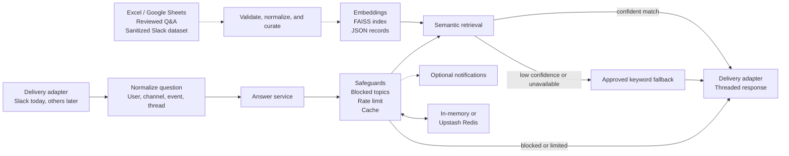

# Architecture

Support Answering Platform is organized around an answer service that is
independent of the transport that delivered the question.

## System flow



The source and indexing path is offline. The event, policy, retrieval, and
response path is online.

## Application layers

```text
routes/
  HTTP transport and request validation

services/
  knowledge matching, retrieval, safeguards, and Slack answering

repositories/
  JSON knowledge storage and persisted FAISS records

integrations/
  Slack, Google Sheets, embeddings, and state-store adapters

core/
  dependency composition and runtime configuration
```

Services do not depend on HTTP request objects or Slack event dictionaries.
Slack normalization happens at the adapter boundary, then the answer service
receives a question plus explicit context such as user, channel, and request
identity.

## Answer decision flow

```text
Incoming event
    ↓
Normalize supported message or mention
    ↓
Claim duplicate event key
    ↓
Blocked topic?
    ├── yes → safe fallback and optional notification
    └── no
         ↓
Rate limit exceeded?
         ├── yes → rate-limit response and optional notification
         └── no
              ↓
         Cached semantic answer?
              ├── yes → return cached answer
              └── no
                   ↓
             Semantic retrieval
                   ↓
             Confidence threshold met?
                   ├── yes → return approved semantic answer
                   └── no → use approved keyword fallback
```

Policy checks happen before keyword fallback. This prevents a restricted topic
from reaching a sensitive keyword answer merely because semantic retrieval did
not find a match.

## State boundaries

The state-store protocol supports cache values, rate counters, and event-aware
rate decisions.

- The in-memory adapter is deterministic and useful for tests or one process.
- Upstash Redis provides shared state for a distributed deployment.
- `none` disables RAG safeguards explicitly when a caller needs an unguarded
  composition for a controlled use case.

Duplicate claims are separate from RAG rate state. A multi-worker deployment
needs a shared duplicate-event store as well as shared RAG state if it must
coordinate delivery across workers.

## Platform boundary

Slack is an integration, not the core identity of the answering system.

```text
Slack event adapter
        ↓
SlackAnsweringService
        ↓
RagKnowledgeBaseService
        ↓
SemanticRetrievalService + KnowledgeBaseService
```

A future web, Discord, Teams, or command-line adapter should normalize its own
event into the same answer-service boundary rather than copying retrieval and
policy logic.
